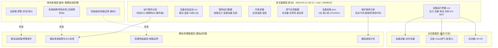
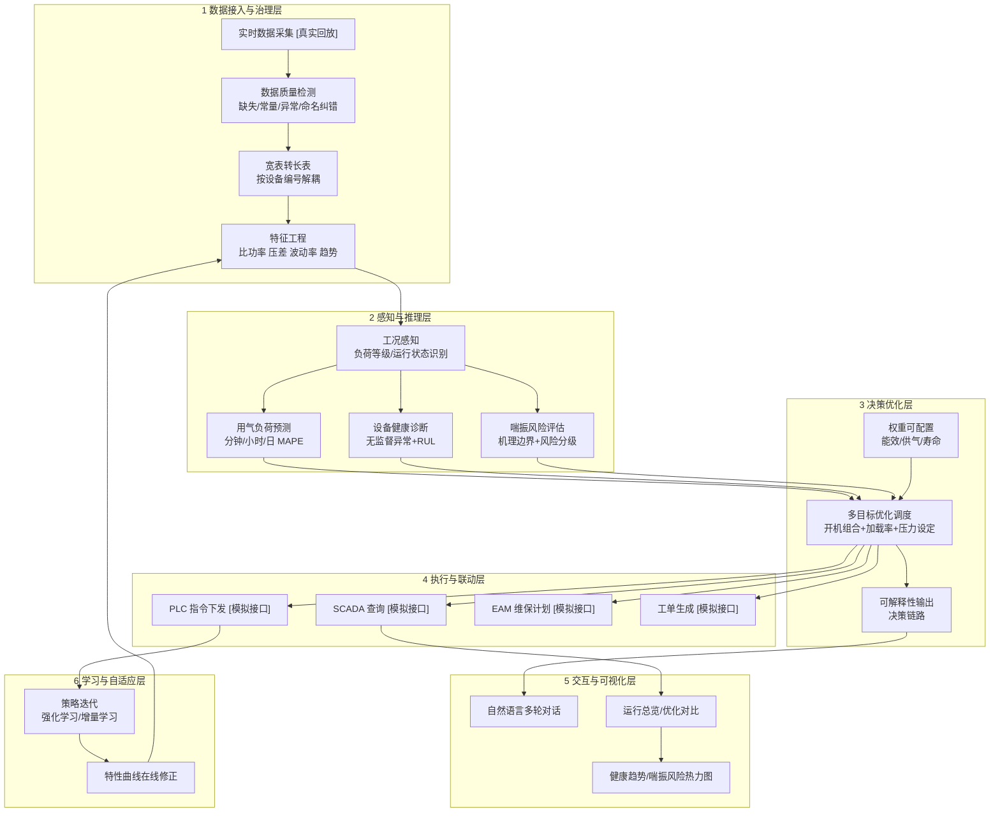
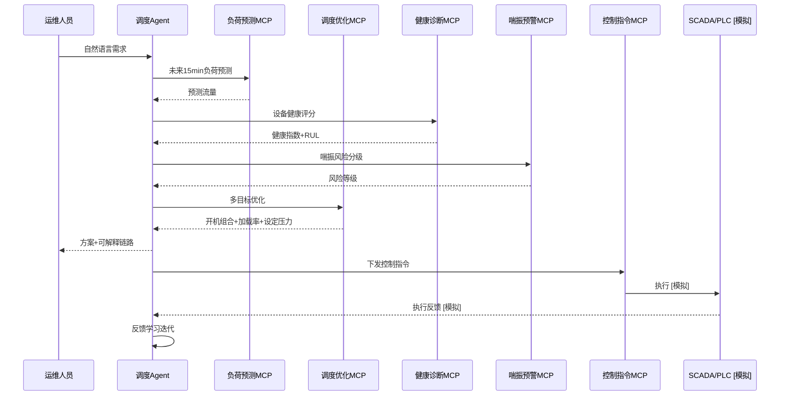

# 阶段 1 交付物 E：项目总体架构图

- 项目：空压站多机协同智能调度 Agent
- 图中每个数据/模块节点都标注 **[真实]** 或 **[模拟]** 或 **[机理]**
- 遵循 Mermaid 标签规范：单行标签、含特殊字符用双引号包裹

---

## 1. 数据来源与可信度分层

---

## 2. 系统分层架构

---

## 3. Agent 决策闭环（时序图）

---

## 4. 真实/模拟边界一览

| 环节 | 数据/能力 | 性质 | 说明 |
|------|-----------|------|------|
| 运行工况数据 | 压力/流量/电流/功率/IGV/BOV | [真实] | 完整、分钟级、无缺口 |
| 状态监测数据 | 振动/温度 | [真实] | 前 6 天中冷/后冷缺测 |
| 环境数据 | 站房温湿度 | **[真实]** | v3 已恢复；大气压常量可忽略 |
| 设备档案 | 2 台机组参数 | [真实] | 静态 |
| 负荷预测 | 分钟/小时/日 | [真实可回测] | 最扎实的可验证能力 |
| 能效/压力基准 | 比功率/波动 std | [真实基准] | 作为对比分母 |
| 运行状态 | 状态 8/10 | **[真实]** | 与功率一致率 >99% |
| 故障事件 | 故障码 26 事件段 | **[真实-事件级弱标签]** | 仅 1 种码、事件极少且疑似共因 |
| 加卸载/预警 | 加卸载列空、预警恒 0 | **[缺失]** | 只能由 IGV/BOV/功率反推 |
| 维保决策 | 运行/负载/保养剩余时间 | **[真实]** | 4# 含 65535、4.29e9 哨兵需清洗 |
| 喘振边界/预警 | 边界曲线+预警 | [机理+模拟] | 无真值，须声明 |
| 故障诊断/RUL | 健康指数+寿命 | [无监督+模拟] | 无 RUL 与多类故障标签 |
| SCADA/PLC/EAM | 控制与工单接口 | [模拟API] | 赛题明确为模拟接口 |
| 强化学习迭代 | 策略优化 | [模拟环境] | 无法在线验证效果 |

---

## 5. 阶段 2 落地建议（数据侧）

1. 以 `设备运行参数 + 设备状态监测 + 环境参数` 为**真实主干**，构建分钟级特征宽表并转长表（`time, device_id, indicator, value`）。
2. 派生表（用气负荷、管网）仅用于**口径校验与复用**，不重复计入模型输入。
3. 单列 `data/simulated/` 存放：模拟喘振/故障/维保事件、机理性能曲线与喘振边界，附生成脚本与随机种子。
4. 所有含模拟成分的赛题指标，在方案与答辩中**显式标注来源**，给出"真实基准 vs 模拟优化"边界。
