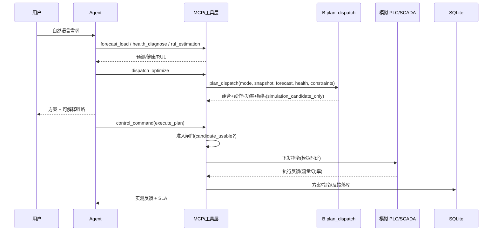

# C 模块技术报告：后端 / MCP / Agent / 模拟控制闭环

> 版本：v1.0（对应 `origin/main @ 032e485` 与分支 `feat/c-backend-agent`）
> 定位：C 负责把 A（数据/预测/健康/RUL）与 B（调度/安全）的能力封装为可运行服务，并打通“感知→决策→执行→反馈”闭环。

---

## 1. 模块定位与职责

| 职责（README §14） | 落地实现 |
|---|---|
| 建设 API 和数据库 | FastAPI + SQLAlchemy/SQLite |
| 封装预测、健康、调度、控制 MCP 工具 | `mcp_servers/`（8 个工具，stdio + streamable-http） |
| 建立 Agent 工作流 | `agent/`（意图理解 + 工具链编排 + 多轮会话 + 可解释链路） |
| 定义统一错误响应 | `api/errors.py`（code/message/detail/request_id） |
| 使用模拟 PLC/SCADA 完成执行闭环 | `control/`（模拟 SCADA/PLC/EAM + 准入闸门 + 安全联锁） |

补充：C 额外承担 **C→B 集成桥**（`integration/`）与 **RUL 封装**（A6）。

---

## 2. 技术栈

- 语言/运行时：Python 3.11
- Web 框架：FastAPI ≥0.110 + Uvicorn ≥0.29（Pydantic v2）
- 数据校验：pydantic ≥2.6
- 数据库：SQLAlchemy ≥2.0 + SQLite（`artifacts/air_station.db`，可用 `AIRSTATION_DB_URL` 覆盖）
- MCP：官方 `mcp` SDK（`MCPServer`，支持 stdio 与 streamable-http）
- 模型/算法依赖（复用 A/B）：pandas、numpy、scipy、scikit-learn、lightgbm、pyarrow、pyyaml
- 网络客户端：httpx（可选 LLM）
- 测试：pytest

---

## 3. 目录结构与职责

```text
src/air_station/
├─ api/                    # 后端 REST 层
│  ├─ app.py               # 应用工厂 + lifespan + CORS + 路由挂载 + 控制台入口 run()
│  ├─ errors.py            # 统一错误响应与异常处理器 + 请求级 request_id 中间件
│  ├─ schemas.py           # 请求模型
│  └─ routers/
│     ├─ system.py         # 首页/探针/信息/总览
│     ├─ models.py         # 预测/健康/RUL/调度/喘振
│     ├─ control.py        # 控制/SCADA/EAM/工单
│     ├─ agent.py          # Agent 对话/会话
│     └─ metrics.py        # 指标对比
├─ mcp_servers/
│  ├─ server.py            # MCP Server 入口（stdio / streamable-http）
│  └─ tools.py             # 8 个 MCP 工具封装
├─ agent/
│  ├─ intent.py            # 规则意图引擎（关键词/实体抽取）
│  ├─ llm.py               # 可选 OpenAI 兼容 LLM（失败自动回退规则）
│  └─ workflow.py          # 编排、可解释、多轮、CLI 入口
├─ integration/
│  ├─ dispatch_bridge.py   # A/C 输入 → B plan_dispatch，透传输出
│  └─ surge_bridge.py      # 当前工况 → B assess_surge_risk
├─ control/
│  ├─ simulator.py         # 内存站级状态机（模拟 SCADA/PLC，含时延）
│  ├─ interlock.py         # 安全联锁（最少运行台数/流量限值）
│  ├─ eam.py               # 模拟 EAM（维保计划/工单）
│  └─ service.py           # control_json() 统一入口 + 准入闸门 + 执行闭环
└─ db/
   ├─ base.py              # 引擎/会话工厂/init_db
   ├─ models.py            # 5 张表 ORM
   └─ repository.py        # 仓储层（写入/查询）
configs/agent.yaml          # Agent 编排与 LLM 配置
configs/control.yaml        # 模拟执行环境/安全联锁/SLA
deployment/                 # Dockerfile + docker-compose.yml
tests/{api,agent,control,db,mcp}/   # C 模块测试
```

---

## 4. 总体架构与数据流

```mermaid
flowchart TB
    U["前端(D) / 运维人员 / 第三方"] --> API["FastAPI /api/*"]
    U --> MCP["MCP Server (stdio / streamable-http)"]
    LLM["Agent LLM(可选, 失败回退)"] --> AG["Agent 工作流"]
    API --> AG
    MCP --> AG
    API --> SVC["工具封装层 tools.py"]
    AG --> SVC
    SVC --> A["A: forecast/health/rul"]
    SVC --> BR["C→B 集成桥 integration/"]
    BR --> B["B: plan_dispatch / assess_surge_risk"]
    SVC --> CTRL["C: 模拟 SCADA/PLC/EAM"]
    CTRL --> GATE["准入闸门 + 安全联锁"]
    CTRL --> DB["SQLite / SQLAlchemy"]
```



闭环时序（自然语言→执行）：



---

## 5. 核心实现

### 5.1 API 层（FastAPI）

- 应用工厂 `create_app()`：lifespan 初始化数据库、CORS、统一异常处理、路由挂载（`api/app.py`）。
- 控制台入口 `run()`：`air-station-api`，默认 `0.0.0.0:8000`（`AIRSTATION_HOST/PORT` 可覆盖）。
- 统一错误响应（`api/errors.py`）：

```json
{"status":"error","error":{"code":"E_DATA_MISSING","message":"...","detail":{},"request_id":"..."}}
```

  错误码映射：`E_VALIDATION`(400/422)、`E_DATA_MISSING`(404)、`E_NOT_FOUND`(404)、`E_METHOD`(405)、`E_RUNTIME`(500)、`E_INTERNAL`(500)；服务层异常（文件/模型/配置缺失）在边界统一转换，**不伪造 success**。
- 请求级 `X-Request-Id`（中间件生成，响应头回传，与 `error.request_id` 一致）。

**REST 端点清单**

| 方法 | 路径 | 说明 |
|---|---|---|
| GET | `/` | 服务首页/能力清单（根路径即首页） |
| GET | `/api/system/health` | 存活探针 |
| GET | `/api/system/info` | 服务信息与 MCP 工具列表 |
| GET | `/api/system/overview` | 运行总览（SCADA+健康+RUL+喘振） |
| POST | `/api/forecast` | 用气负荷预测（A） |
| POST | `/api/health` | 设备健康诊断（A） |
| POST | `/api/rul`；GET `/api/health/rul` | 剩余寿命估计（A，模拟） |
| POST | `/api/dispatch` | 多机调度优化（B） |
| GET | `/api/dispatch/plans` | 历史调度方案 |
| POST | `/api/surge` | 喘振代理评估（B） |
| POST | `/api/control/command` | 控制指令（7 种 action） |
| GET | `/api/control/commands/{id}` | 指令状态 |
| GET | `/api/scada/realtime` | 站级实时快照（模拟） |
| GET | `/api/scada/history` | 单机历史序列 |
| GET | `/api/eam/maintenance` | 维保计划（模拟 EAM） |
| POST/GET | `/api/workorders` | 工单生成/列表 |
| POST | `/api/agent/chat` | 自然语言交互（多轮） |
| GET | `/api/agent/sessions` `/api/agent/sessions/{id}` | 会话列表/详情 |
| GET | `/api/metrics/comparison` | 优化前后/模型指标对比 |

### 5.2 MCP 服务层

- Server：`mcp_servers/server.py`，`MCPServer(name="air-station-agent")`，注册 8 个工具。
- 传输：`air-station-mcp`（stdio）或 `python -m air_station.mcp_servers.server --http --host 0.0.0.0 --port 8765`（streamable-http，路径 `/mcp`）。
- 封装原则：只调用 A/B/C 服务层，不复制算法，不改成功响应字段。

**工具与来源映射**

| MCP 工具 | 含义 | 底层来源 |
|---|---|---|
| `forecast_load` | 15/30/60 分钟负荷预测 | A `forecast_json()` |
| `health_diagnose` | 健康评分/风险/建议 | A `health_json()` |
| `rul_estimation` | 剩余寿命（模拟） | A `rul_json()` |
| `dispatch_optimize` | 多机调度（b3/balanced/load_balanced/joint_nompc） | B `b_api.plan_dispatch`（经 `integration/`） |
| `surge_warning` | 喘振代理评估 | B `assess_surge_risk` |
| `control_command` | SCADA/PLC/EAM（7 actions） | C `control_json()` |
| `create_work_order` | 维保工单 | C `control/eam.py` + DB |
| `orchestrate` | 自然语言编排 | C `agent/workflow.py` |

### 5.3 Agent 工作流

- 意图引擎（规则，`agent/intent.py`）：8 类意图
  `control_execute / workorder / surge_query / rul_query / dispatch_optimize / forecast_query / health_query / status_overview / unknown`；
  实体抽取：机组号（4#/5#）、时域（15/30/60 分钟）、需求流量（m3/min）。
- 可选 LLM（`agent/llm.py`）：OpenAI 兼容接口，`engine=auto|rule|llm`；不可用时自动回退规则引擎（确定性、离线可测）。
- 编排（`configs/agent.yaml` 的 `pipelines`）：按意图执行工具链，例如
  `dispatch_optimize → [forecast_load, health_diagnose, rul_estimation, surge_warning, dispatch_optimize]`；
  `control_execute → [dispatch_optimize, control_command]`（仅 `execute=true` 才真正下发）。
- 输出：`intent / answer（自然语言）/ tools_used / explain_chain（可解释链路）/ follow_up / plan / tool_results / context`。
- 多轮：携带 `session_id` 复用上下文（≥10 轮），会话落库。

### 5.4 C→B 集成桥（`integration/`）

- `build_snapshot()`：由 `data/processed/*.parquet` 构造 B 的 `StationSnapshot`。
- `build_forecast()`：调 A `forecast_json()` 取对应时域，构造 `ForecastResult`（或按覆盖需求构造）。
- `build_health()`：调 A `health_json()`，构造 `HealthAssessment` 列表。
- `build_constraints()`：读 `configs/optimization.yaml`，构造 `DispatchConstraints`（阈值外部化）。
- `dispatch_plan(mode, ...)`：调用 `b_api.plan_dispatch`（mode ∈ `{b3, balanced, load_balanced, joint_nompc}`），**原样透传 B 输出**并附加 `c_meta`
  （`candidate_usable / needs_human_review / is_success / is_fallback / is_blocked / is_infeasible / execution_allowed(=false) / api_version / elapsed_seconds`）；`joint_nompc` 可能带 `degraded` 标记。
- `surge_assessment()`：以当前工况构造“保持”候选 `DispatchResult`，调用 `b_api.assess_surge_risk`，透传 `SurgeAssessment` 并派生 `station_risk_level`。

### 5.5 控制闭环（模拟）

- 模拟站（`control/simulator.py`）：由 `device_timeseries.parquet` 末值初始化内存状态；下发带模拟时延（`latency_ms`/`feedback_delay_ms`），反馈含实测流量/功率（功率用 B 的 `performance.estimate_power` 估算）。
- 统一入口（`control/service.py::control_json`）7 个 action：
  `scada_query / scada_history / plc_command / execute_plan / eam_maintenance / work_order / command_status`。
- **准入闸门**（`_plan_gate`）：B 输出恒为 `simulation_candidate_only` 且 `execution_allowed=false`；
  仅当 `candidate_usable`（成功且未阻断）才在模拟环境下发；`is_blocked`（安全阻断）/`is_infeasible`/`is_fallback` 一律拒绝并需人工复核。
- **安全联锁**（`control/interlock.py`）：最少运行台数、目标流量上下限、动作合法性；被拒返回 `accepted=false` + `rejected_reason`。
- SLA 字段：`sla_ok.command_dispatch(≤3s)`、`sla_ok.feedback_return(≤10s)`、`work_order.sla_ok(≤30s)`。
- 硬开关：`configs/control.yaml` 的 `simulation.allow_real_device=false`。

### 5.6 数据库

`db/models.py` 5 张表：

| 表 | 内容 |
|---|---|
| `agent_sessions` | 会话（输入/意图/回答/工具/上下文） |
| `dispatch_plans` | 调度方案（B 输出，字段容错映射） |
| `control_commands` | 控制指令与状态 |
| `execution_feedback` | 执行反馈 |
| `work_orders` | 维保工单 |

`db/repository.py` 提供写入/查询（会话、方案、指令、反馈、工单）。

### 5.7 配置

- `configs/agent.yaml`：意图引擎、LLM、`pipelines` 编排策略、DB。
- `configs/control.yaml`：`paths`、`simulation`（时延/新鲜度/真实设备开关）、`sla`、`safety_interlock`。

---

## 6. 关键接口示例

### POST /api/dispatch

```json
{"mode": "b3", "demand_flow_m3_min": 480.0, "horizon_minutes": 15, "timeout_ms": null, "persist": true}
```

响应（B 输出 + `c_meta`，节选）：

```json
{
  "status": "success", "mode": "b3", "is_fallback": false,
  "execution_permission": "simulation_candidate_only", "safety_blocked": false,
  "target_combination": ["4#", "5#"],
  "device_actions": [{"device_id": "4#", "action": "adjust", "target_flow_m3_min": 243.96,
                      "running_after": true}],
  "total_flow_m3_min": 512.86, "estimated_power_kw": 2598.17,
  "surge_status": "low", "reason_codes": [], "latency_ms": 38.3,
  "c_meta": {"candidate_usable": true, "needs_human_review": false,
             "execution_allowed": false, "api_version": "b-api-v1.0", "elapsed_seconds": 1.86}
}
```

### POST /api/control/command（execute_plan）

```json
{"action": "execute_plan", "plan": { ...B 输出... }, "persist": true}
```

响应：`accepted / command_count / results[{device_id,action,accepted,command_status,feedback}] / actual_total_power_kw / requires_human_review / elapsed_seconds`。

---

## 7. 运行与部署

```bash
# 安装
python -m pip install -e ".[dev]"

# 后端 API（根路径 / 即首页，/docs 为接口文档）
air-station-api

# MCP（stdio / streamable-http）
air-station-mcp
python -m air_station.mcp_servers.server --http --host 0.0.0.0 --port 8765

# 命令行 Agent
air-station-agent "优化调度并执行"

# 容器化
docker compose -f deployment/docker-compose.yml up --build
```

---

## 8. 测试与验证

### 8.1 测试分布（分块运行，避开 OOM）

```text
A/A6: 79 passed
B   : 215 passed
C   : 29 passed（含 MCP 协议级测试的分支为 30）
合计: 323 passed, 0 skipped
```

C 覆盖：统一错误与端点（api）、控制闸门/SLA/联锁（control）、仓储（db）、
工具与 MCP 协议（mcp）、Agent 意图与多轮（agent）。

### 8.2 MCP 端到端实验（官方客户端驱动）

- stdio：`initialize` → `tools/list`（8 个）→ `tools/call`（forecast/surge/dispatch）均成功。
- streamable-http：`initialize` → `tools/list` → `tools/call`（health_diagnose）成功。
- 协议级回归测试：`tests/mcp/test_mcp_protocol.py`。

### 8.3 运行时逐项（实测）

统一错误、5 大 MCP、执行闭环、EAM/工单、Agent 多轮、落库、控制 SLA —— 全部 PASS。

### 8.4 时延（实测）

| 环节 | 实测 | 要求 |
|---|---|---|
| 负荷预测 | ~0.5s（热）/ ~3s（冷） | ≤10s |
| 健康诊断 | ~0.9s | — |
| RUL | ~0.4s | — |
| 喘振评估 | ~0.7s | — |
| B 调度算法 | ~38ms（API 含组装 ~1.6–2.0s） | ≤60s |
| 指令下发(+反馈) | ~0.26–0.57s | 下发≤3s / 反馈≤10s |
| 工单生成 | ~0.67s | ≤30s |
| E2E 对话(调度+执行) | ~2.7s | ≤60s |

---

## 9. 安全边界与诚实声明

- 控制、SCADA、EAM 全部为模拟接口，不连接真实 PLC（硬开关 `allow_real_device=false`）。
- B 输出恒为 `simulation_candidate_only`，`execution_allowed=false`；C 准入闸门保证仅 `candidate_usable` 进入模拟执行。
- 喘振为 B 的代理评分/统计边界，非厂家真实喘振线；RUL 为模拟退化模型输出。
- 指令下发另经安全联锁（最少运行台数/流量限值），不绕过设备保护逻辑、不自动真实停机。

---

## 10. 与 A/B/D 的接口关系

- A：C 封装 `forecast_json / health_json / rul_json`，成功响应字段与层级原样透传（见 `analysis/reports/A_to_C_服务接口.md`）。
- B：C 通过 `integration/` 调用 `b_api.plan_dispatch / assess_surge_risk`，透传 B 输出（见 `analysis/reports/b/integration_B_to_C.md`）。
- D：C 提供 `/api/*` 与 MCP 工具供前端对接；根路径 `/` 可直接访问。

---

## 11. 已知限制与后续

- 容器镜像未在本环境实际构建（无 docker）；Dockerfile/compose 已就绪。
- MCP HTTP 传输的 `--host/--port` 生效问题已修复（分支 `fix/c-mcp-http-transport`，提交 `d6beaa5`），待合并。
- 端到端时延已实测达标；B 的官方 KPI 口径与真实喘振标签仍待主办方确认（见 B `OPEN_ITEMS.md`）。
