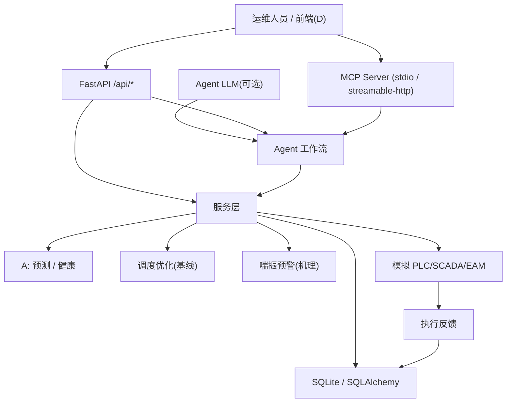

# 阶段 C 交付：后端 / MCP / Agent / 控制闭环

本目录是 C 成员的阶段交付索引。C 负责把 A（数据、预测、健康）与 B（优化、安全）
的能力封装为可运行的服务，并打通“感知 → 决策 → 执行 → 反馈”闭环。

## 1. 交付内容

| 能力 | 代码位置 | 对外的形态 |
|---|---|---|
| 用气负荷预测 | `src/air_station/models/forecasting/service.py` | REST / MCP `forecast_load` |
| 设备健康诊断 | `src/air_station/models/health/service.py` | REST / MCP `health_diagnose` |
| 剩余寿命估计 | `src/air_station/models/rul/service.py` | REST / MCP `rul_estimation` |
| 多机调度优化 | B: `optimization/b_api.plan_dispatch`（C 桥接 `integration/`） | REST / MCP `dispatch_optimize` |
| 喘振风险预警 | B: `safety/surge.assess_surge_risk`（C 桥接 `integration/`） | REST / MCP `surge_warning` |
| 控制指令闭环 | `src/air_station/control/` | REST / MCP `control_command` |
| 数据库 | `src/air_station/db/` | SQLAlchemy + SQLite |
| API 层 | `src/air_station/api/` | FastAPI |
| Agent 工作流 | `src/air_station/agent/` | REST / MCP `orchestrate` |
| C→B 桥接 | `src/air_station/integration/` | 组装 B 输入契约、透传 B 输出 |

## 2. 架构



- `elapsed` 等耗时字段用于检验赛题的时延要求（预测 ≤10s、调度 ≤60s、指令下发 ≤3s、反馈 ≤10s、工单 ≤30s）。
- A 的接口字段被原样透传，C 只做封装，不修改成功响应层级。
- 调度与喘振由 B 的稳定接口产出，C 只组装输入并透传输出（见 `integration/`）。

## 3. 安全边界（重要）

- 所有控制能力只作用于**模拟 PLC/SCADA/EAM**（`configs/control.yaml` 中 `allow_real_device: false`）。
- **准入闸门**：B 的调度输出恒为 `execution_permission="simulation_candidate_only"` 且
  `execution_allowed=false`；仅当 `candidate_usable`（求解成功且未被安全阻断）为真，
  C 才在模拟环境下发；回退(`is_fallback`)/不可行/安全阻断(`safety_blocked`)一律拒绝并需人工复核。
- 指令下发前另经安全联锁：最少运行台数、流量上下限；被拒指令返回 `accepted: false` 及原因。
- 喘振为 B 的**代理评分与统计边界**，非厂家真实喘振线；不得表述为真实预警准确率。

## 4. 快速运行

```bash
# 安装
python -m pip install -e ".[dev]"

# 启动 API (根路径 / 返回能力清单, /docs 为接口文档)
air-station-api
# 或: uvicorn air_station.api.app:app --host 0.0.0.0 --port 8000

# 启动 MCP (stdio)
air-station-mcp
# 或: python -m air_station.mcp_servers.server --http

# 命令行 Agent (调度/喘振调用 B 接口)
air-station-agent "优化调度并执行"
```

## 5. 相关文档

- [API 接口说明](./API接口说明.md)
- [MCP 服务说明](./MCP服务说明.md)
- [控制闭环与安全边界](./控制闭环与安全边界.md)
- 数据/预测/健康字段口径见 `analysis/reports/A_to_C_服务接口.md`
