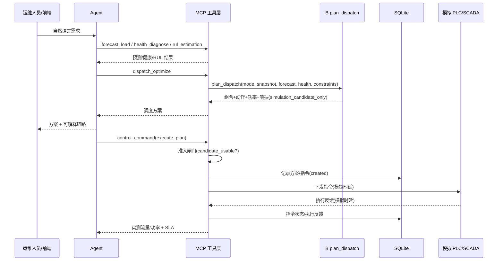

# 阶段 C：控制闭环与安全边界

## 1. 闭环流程

## 2. 模拟接口边界

| 环节 | 实现 | 说明 |
|---|---|---|
| SCADA 查询 | `control/simulator.py` 内存站级状态 | 由 `device_timeseries.parquet` 末值初始化 |
| PLC 下发 | `simulator.apply_command` | 更新内存状态并返回反馈，含模拟时延 |
| EAM 维保 | `control/eam.py` | 读取 `设备档案.json` 保养计划 |
| 工单 | `control/eam.py` + 数据库 | 生成并可查询 |
| 历史序列 | `control/service.py::scada_history` | 直接读取处理后的 Parquet |

`configs/control.yaml` 的 `simulation.allow_real_device=false` 是硬开关，禁止连接真实 PLC。

## 3. 安全联锁（指令下发前强制执行）

`control/interlock.py`：

1. 压力设定值必须落在 `safety_interlock.require_pressure_within` 区间；
2. 停机后运行机组数不得低于 `min_running_units`；
3. 目标流量必须落在 `[0, 额定流量]`；
4. 动作必须属于 `{run, stop, set_load}`。

任一不满足即拒绝，返回 `accepted=false` 与 `rejected_reason`，**不会下发到模拟 PLC**。

## 4. 时延与 SLA

| 指标 | 赛题要求 | 落地字段 |
|---|---|---|
| 负荷预测 | ≤ 10s | `/api/forecast` 的 `elapsed_seconds` |
| 调度方案生成 | ≤ 60s | `/api/dispatch` 的 `elapsed_seconds` |
| 指令下发 | ≤ 3s | `control_command` 的 `sla_ok.command_dispatch` |
| 执行反馈 | ≤ 10s | `control_command` 的 `sla_ok.feedback_return` |
| 工单生成 | ≤ 30s | `work_order` 的 `sla_ok` |

## 5. 数据库

`src/air_station/db/`，默认 SQLite：`artifacts/air_station.db`（可用环境变量
`AIRSTATION_DB_URL` 覆盖）。

| 表 | 内容 |
|---|---|
| `agent_sessions` | Agent 会话（输入/意图/回答/上下文） |
| `dispatch_plans` | 调度方案与节能对比 |
| `control_commands` | 控制指令与状态 |
| `execution_feedback` | 执行反馈 |
| `work_orders` | 维保工单 |

## 6. 边界声明

- 控制、SCADA、EAM 全部为模拟接口，禁止用于真实设备操作。
- 调度与喘振由 B 的稳定接口产出（`b_api.plan_dispatch` / `b_api.assess_surge_risk`），
  C 只组装输入并透传输出；B 输出恒为 `simulation_candidate_only`，无真实执行许可。
- C 的**准入闸门**保证仅 `candidate_usable` 的方案进入模拟执行；回退/不可行/安全阻断一律拒绝。
- B 的喘振为代理评分与统计边界，非厂家真实喘振线；节能对比口径以 B 的
  `baseline_comparison` 为准，如实呈现，不做粉饰。
